# A smaller public surface for 1.0

At 1.0, every name eve exports and every shape it accepts or returns becomes a compatibility
promise. Today that is 2,005 names over 84 entry points, and most of them were never meant as
API: about 450 are named anywhere in the docs, apps, or e2e. The rest are re-exports of the same
symbol from several entry points, helpers eve's own code paths use, and parallel shapes for one
concept, such as five request-status vocabularies and ten ways to return from an approval
policy.

This plan commits 1.0 to about 1,350 names and one shape per concept, with three changes:

1. **Consolidate**: one API per concept, not several that grew side by side.
2. **One home per name**: each name is exported from the entry point that documents it.
3. **Keep internals internal**: export what an agent author touches, not what eve uses.

Anything an app can build from what remains, or that eve's users ask for later, can be added
after 1.0. A removal can't.

## Rules

- **No thin APIs.** An API that only saves an app a few lines, such as a callback derivable from
  the snapshot or a wrapper around `send`, is easy to add later and hard to remove. Leave it out
  unless it does something an app can't. `calledTool` stays on that test: 340 uses.
- **Expose facts, not interpretations.** Names like `onFinish` commit eve to one meaning of "done".
  Expose the stream and the view, and let apps decide.
- **One home per name.** A type or value is exported from the entry point that documents it, and
  nowhere else. A framework entry (`eve/react`, `eve/vue`, `eve/svelte`) also re-exports the types
  its hook returns, so an app imports from one place.
- **What an author touches, not what eve uses.** Loader brands and sentinels, writer helpers,
  wire constants, and wrappers around platform APIs stay internal.
- **Own the types we expose.** A public signature doesn't carry a peer dependency's type that
  moves with the app's installed version. eve copies the shape and adapts at runtime if it drifts.
- **Unexport a type only where that buys name freedom.** An unexported type is still part of the
  contract through the signatures that reach it; only its name goes, and a consumer that emits
  declarations for a value whose inferred type contains it gets a non-portable import into eve's
  `dist`. So a type stays exported if it's a public function's return type, if users plausibly
  build standalone values of it (rubrics, shared options, responder functions), or if a versioned
  protocol already freezes its shape (agent-info, `eve invoke`, MCP). Types read only from
  contexts, or written inline, lose their names.

## What 1.0 promises

- Every entry point except `eve/experimental/*` and `eve/internal/*` carries a compatibility
  promise. Those two prefixes carry none, stated once in `reference/typescript-api.md`.
- The session stream's facts (v27), agent-info, `eve invoke`'s JSON, and the MCP schemas are
  versioned protocols. The 1.0 release serves remote-agent protocols 1 to 3.

## Keeping it small

The surface is checked, not just reduced once. Each public entry point gets a committed list of
the names it exports, generated by the TypeScript checker, and `pnpm guard:invariants` fails when
an entry point's exports differ from its list. Adding, removing, or renaming a public name then
shows up as a deliberate diff in review, and the after-counts below become measurements once the
cleanup lands.

## Surface area

Exported names by group, measured with the TypeScript checker over the 84 entry points it
resolves at #4855 (types and values; the eight generated extension entries need a build).
After-counts apply this plan's decisions, rounded where a decision was sized rather than listed:

```mermaid
xychart-beta
  title "Exported names by group (today vs after)"
  x-axis ["Platform channels", "Clients and hooks", "Authoring", "eve/events", "Channel framework", "Setup", "Instrumentation", "Evals", "Built-in tools", "Extensions"]
  y-axis "Names" 0 --> 600
  bar [559, 333, 288, 219, 139, 131, 100, 92, 61, 61]
  bar [397, 129, 266, 201, 132, 0, 41, 64, 47, 48]
```



| Group                          | Today     | After      | Mostly through                                                        |
| ------------------------------ | --------- | ---------- | --------------------------------------------------------------------- |
| Platform channels (10 entries) | 559       | ~400       | internal: API wrappers, rendering and verification helpers, constants |
| Clients and hooks              | 333       | ~130       | one home: `eve/client`'s 175 re-exports of `eve/events`               |
| Agent authoring (26 entries)   | 288       | ~265       | consolidation: approval families, sandbox types, duplicates           |
| `eve/events`                   | 219       | ~200       | internal: writer helpers, extra folds, the fact zod schemas           |
| Channel framework              | 139       | ~130       | consolidation: control results, one CORS type                         |
| Setup wizard                   | 131       | 0          | internal: `eve/setup` removed, `eve/setup/scaffold` to `eve/internal` |
| Instrumentation                | 100       | ~40        | consolidation: one generic event type instead of ~18 named ones       |
| Evals                          | 92        | ~65        | consolidation: call types and matchers; judge and mock field types    |
| Built-in tools (13 entries)    | 61        | ~47        | internal: schema constants duplicating each definition's own          |
| Experimental and extensions    | 61        | ~48        | self-modification's legacy entry points                               |
| Framework adapters             | 22        | 21         | one constant                                                          |
| **Total**                      | **2,005** | **~1,350** |                                                                       |

Names undercount consolidation, which mostly removes variants and members rather than exports:

```mermaid
xychart-beta
  title "Shapes per concept (today vs after)"
  x-axis ["Request statuses", "Command results", "Approval returns", "Call assertions", "Interaction types", "Payload types", "Instrumentation keys", "Frontend callbacks"]
  y-axis "Shapes" 0 --> 15
  bar [5, 12, 10, 11, 8, 5, 14, 5]
  bar [1, 3, 5, 6, 3, 1, 9, 1]
```



## 1. Consolidate

### Session commands and handles

Every send, answer, and control is a delivery in v27, but only sends report one, and each control
returns its own type twice (client and channel). Every command on every side now returns one
result: a `Delivery` you can follow, or a rejection.

```ts
type CommandResult<TOutput = unknown> =
  Delivery<TOutput> | { readonly status: "not-active"; readonly retryable?: true };

interface Delivery<TOutput = unknown> extends AsyncIterable<SessionStreamEvent> {
  readonly status: "accepted";
  readonly sessionId: string;
  readonly deliveryId: string;
  result(): Promise<DeliveryResult<TOutput>>; // { status: RequestStatus, sessionEnded, reply?, data?, interactions }
}
```

```ts
// before
const response = await session.send("Summarize the thread"); // MessageResponse
const { status } = await response.result(); // "completed" | "failed" | "waiting"
const cancelled = await session.cancel(); // CancelSessionResult, "no_active_turn"

// after
const sent = await session.send("Summarize the thread");
if (sent.status === "not-active") return retryLater(sent.retryable);
const { status, reply } = await sent.result(); // status: RequestStatus

const cancel = await session.cancel(); // a CommandResult, like every command
if (cancel.status === "accepted") await cancel.result(); // once the cancel took effect
```

- Handles share two interfaces. `SessionReader` (`id`, `stream()`) is what `eve/server`'s
  `sessions.attach(id)` and a client's child-agent handle get. `SessionOperations` adds the
  commands, only where an authenticated principal is already in hand: channel routes, schedules,
  and the client. No handle gains a power it lacks today. `ServerSession` goes.
- Every handle names its session `id` and reads with `stream()`, an `AsyncIterable` whose first
  read checks the session, so a route that awaits the first event can still answer a stranded
  session with an error status. `getEventStream()`, `getLineStream()`, and `getChildBinding()`
  go.
- `ChannelSource.send()` returns the result, not a handle; `attachSession(sent.sessionId)` makes
  one without I/O. A `Delivery`'s data fields are its own properties, so
  `Response.json(await from(id).cancel())` serializes the receipt.
- The frontend store's local clear is `newSession()`, and `reset()` means the server-side retire,
  as on every other handle. `eve/context`'s data-only `Session` is renamed `SessionInfo`.
- `TOutput` is inferred from `outputSchema` wherever a Standard Schema is accepted (the client,
  the frontend store and hooks, workflow `ctx.agent().send()`). The server takes a JSON Schema
  object, so its `data` is `unknown`.

Options share `outputSchema` (and `turnPolicy` on sends); each side adds what only it knows:

| Side                   | `send`                                                                                      | `respond`                                  |
| ---------------------- | ------------------------------------------------------------------------------------------- | ------------------------------------------ |
| Server (channels)      | `auth`, `state`, `context`, `outputSchema`, `turnPolicy`, `title` (on creation)             | `auth`, `state`, `context`, `outputSchema` |
| Client, store, hooks   | `clientContext`, `outputSchema`, `turnPolicy`, `signal`, `headers`, `streamReconnectPolicy` | the same, without `turnPolicy`             |
| Workflow `ctx.agent()` | `outputSchema`, `signal`                                                                    | none                                       |
| Schedules' `to().send` | `auth`, `turnPolicy`                                                                        | none                                       |

`callback` and `initiatorAuth` go. `context` and `clientContext` stay separate because they mean
different things: a server's `context` is kept in history, a client's `clientContext` only for the
current turn.

### Request statuses

"How did my request end" has five vocabularies today. One type and selector in `eve/events`
replace them, and every surface projects it:

```ts
type RequestStatus = "working" | "awaiting-input" | "completed" | "failed" | "cancelled";
function requestStatus(view: SessionView, deliveryId: string): RequestStatus;
```

| Surface                               | Today                                                                                     | After                                                                |
| ------------------------------------- | ----------------------------------------------------------------------------------------- | -------------------------------------------------------------------- |
| `MessageResult`, `AgentMessageResult` | `completed \| failed \| waiting`; `completed` when the session ended                      | `RequestStatus` and a separate `sessionEnded`                        |
| MCP `agent_*`                         | `working \| input_required \| authorization_required \| completed \| failed \| cancelled` | the same without `authorization_required`; sign-ins are interactions |
| `eve invoke`                          | `running \| input-required \| ready \| failed \| authentication-required`                 | `RequestStatus`; a deployment sign-in failure is a CLI error         |

`invokeTool` isn't a request: it runs one tool outside any conversation and never waits for a
person. Its result takes the call's vocabulary:

```ts
type InvokeToolResult =
  | { outcome: "completed"; output: unknown; modelOutput: ToolModelOutput }
  | { outcome: "failed"; error: ErrorInfo }
  | {
      outcome: "rejected";
      reason: string;
      connections?: readonly string[];
      cause?: { policy: string };
    };
```

### Approval policies

`ApprovalStatus` accepts ten forms, read by three normalizers. `"approved"` behaves like
`"not-applicable"`, its reason is dropped, and a policy approval records nothing on the stream.

```ts
// before
approval: ({ session, toolInput }) => {
  if (session.auth.current?.attributes.tenantId !== toolInput?.tenantId) {
    return { type: "denied", reason: "Caller cannot access this tenant." };
  }
  return (toolInput?.amount ?? 0) > 1000 ? "user-approval" : "not-applicable";
},
response: ({ responder }) =>
  isApprover(responder) ? { status: "allowed" } : { status: "rejected", reason: "Not an approver." },

// after
approval: ({ session, toolInput }) => {
  if (session.auth.current?.attributes.tenantId !== toolInput?.tenantId) {
    return { deny: "Caller cannot access this tenant." };
  }
  if ((toolInput?.amount ?? 0) > 1000) return "ask";
  // returning nothing allows
},
response: ({ responder }) => (isApprover(responder) ? "admit" : { refuse: "Not an approver." }),
```

- A request policy returns `"allow" | "ask" | "deny" | { deny: string }`; booleans go. A response
  policy returns `"admit" | { refuse: string }`, in different words on purpose: refusing a
  responder keeps the approval open for someone else and decides nothing about the call.
- `approvalKey` and `approvedTools` go. `once()` stays, keyed by tool name. Scoped memory
  ("approve once per environment") becomes a documented recipe: `defineState`, a hook on
  `interaction.settled` that records the approved call's key, and a policy that reads it.
- `Approval` and `ApprovalConfiguration` absorb the tool-only `ToolApproval` family (an optional
  `prompt`). `ApprovalRequest`, `ApprovalResponse`, and their auth and session types lose their
  names; the response policy's session is a `Pick` of `SessionContext`.

### Evals

Eval sessions, turns, and results carry the session's `view`, and calls are read from
`view.calls` instead of three parallel extractions.

```ts
// before
t.calledSubagent("researcher");
t.usedNoTools();
t.noFailedActions();
turn.parked();
const turn = await t.target.attachSession(id, { startIndex: session.state!.streamIndex });
const live = t.target.watchTurn(id, { startIndex });

// after
t.called("researcher", { kind: "agent" });
t.called({ kind: ["tool", "agent", "control"], count: 0 }); // every call but skill loads
t.noFailedCalls();
turn.awaitingInput();
const session = t.target.attach(id); // no I/O, tracks its own cursor
const turn = await session.nextTurn();
const live = session.watch();
```

- `calledTool` stays as a shim over `called` with `kind: "tool"`. `loadedSkill` (28 uses) and
  `calledSubagent` (35) don't earn one.
- `toolCalls`, `skillLoads`, `subagentCalls`, `toolCallsOf`, their types and matchers, and
  `EveEvalActionStatus` go. `derived` becomes `summary`. Results use `RequestStatus`,
  `sessionEnded`, `reply`, and `data`.
- `eventsSatisfy`, `respondAll`, and `transcript` stay: each is documented and widely used.
- `JudgeContext`, `JudgeBatch`, `JudgeInput`, `ScoreInput`, and five `MockModel…` field types lose
  their names; the request, response, responder, and tool-call types stay, since users build
  responders and rubrics as standalone values.
- Reporters: `eveStatus` takes the new values, `eveSessionEnded` is added, `eveParked` becomes
  `eveAwaitingInput`, and agent-call metrics are named for agents. Saved queries on the old names
  need a one-time edit.

### Channel delivery and identity

A channel's `deliver()` hook receives an open bag (`[key: string]: unknown`) that carries the
documented per-delivery `state` beside eve's internal keys, and returns the harness's `StepInput`.
One typed payload replaces the five overlapping types:

```ts
interface ChannelDelivery<TState = undefined> {
  readonly message?: MessageContent;
  readonly answers?: readonly Answer[];
  readonly context?: readonly string[];
  readonly outputSchema?: JsonObject;
  readonly state?: Partial<TState>;
}

deliver(payload, channel) {
  const cards = payload.state?.pendingPromptCards; // typed, no cast
  // return nothing to deliver the payload unchanged
}
```

Channel identity gets one value everywhere: `channel:<name>` for authored channels, and `http`,
`schedule`, or `subagent` for eve's own. Today a hook's `ctx.channel.kind` stays `"http"` for an
authored channel with no behavior, so `isChannel(ctx.channel, myChannel)` never matches it.
`kindHint`, which registration overwrites, and the deprecated `metadata().audience` projector go.

### Smaller consolidations

- **Connections:** one ownership field, `principalType: "app" | "user"`; the deprecated
  `credentialOwner` alias union goes, and `ConnectionAuthProvider` merges into
  `AuthorizationDefinition`.
- **Instrumentation:** events are typed with one generic, `InstrumentationEvent<"turn.settled">`,
  as hooks are with `HookEvent<K>`, replacing ~18 named interfaces and ~15 sub-payload aliases.
- **Sandbox:** `RuntimeSandboxSession` and `RuntimeSandboxSessionFor<S>` merge into
  `RuntimeSandboxSession<S = SandboxSession>`. The eight method option types
  (`SandboxRunOptions`, `SandboxSpawnOptions`, the read and write options) stay: provider authors
  name them when implementing a session, and wrappers build them as values.
- **Naming:** `agent` names calls, tasks, and wire facts; `subagent` names only local definitions,
  so `followSubagents` becomes `followAgents`. Both `auto` exports keep their names.
- **Channel CORS:** `EveChannelCors` merges into `ChannelCors`, which also accepts one origin
  string.
- **Memory providers:** the keys are named after v26 events hooks now reject; they take names for
  what they do, in two pairs, and post-compaction recall stays:

  ```ts
  defineMemoryProvider({
    recall: { beforeTurn, afterCompaction },
    capture: { beforeCompaction, afterTurn },
  });
  ```

  Reactions (#4616) drops post-compaction recall because recalled memory moves outside history
  there. A provider still needs it to bring back what the summary lost and to prune recall that
  accumulated; the [proposal on #4616](https://github.com/vercel/eve/pull/4616#issuecomment-6202534510)
  makes `afterCompaction` return the slot's full set. This lands coordinated with #4616.

## 2. One home per name

263 exported names re-export a symbol another entry point already exports. Each moves to the
entry point that documents it:

```ts
// before
import type { CallRow, SessionView, SessionStreamEvent } from "eve/client";
import { isChannel } from "eve/instrumentation";

// after
import type { CallRow, SessionView } from "eve/events";
import type { SessionStreamEvent } from "eve/client";
import { isChannel } from "eve/channels";
```

- `eve/client` stops re-exporting `eve/events` (175 names). The wildcard dates from v26, when stream
  types lived only in the server package; `eve/events` now has no runtime dependencies. Two e2e
  imports move.
- `isChannel` and the `InstrumentationChannel*` types leave `eve/instrumentation`, where they were
  kept "so existing imports continue to work" since the first commit.
- `SessionContext` is exported from `eve/context` only, `JsonValue` and the trace-policy types
  once, assertion types from `eve/evals` only, and one `RuntimeIdentity` and `TraceContext`.
- `ToolStub` leaves `eve/client` (documented under evals); `defaultWebSearch` (the default export
  under a third name) goes; the bare `eve/self-modification` entry (the same file as `/local`)
  goes.
- The `ModelMessage` re-exports from the Slack, Telegram, Teams, and Discord entry points go: no
  channel API uses the type.

## 3. Keep internals internal

What eve's own code paths need stays inside the package:

- **Setup:** `eve/setup` (77 names, imported nowhere outside eve) is no longer exported.
  `eve/setup/scaffold` (54) moves to `eve/internal/scaffold`, exporting only what vercel-site's
  Agent Builder codegen uses: five values and their option types.
- **Platform channels:** an entry exports the factory, `default…Auth`, `…ContinuationToken`, and
  the config, credentials, state, handler, handle, thread, and payload types. Typed API wrappers,
  interaction rendering, request verification and signing, TwiML builders, and constants become
  internal: inside a handler the channel handle already gives raw access. Kept because they are
  documented or used outside a handler: Slack's `callSlackApi`, `resolveSlackBotToken`,
  `postCompletedSlackReply`, `loadThreadContextMessages`, renderer, answer helpers, and card
  builders; Linear's `callLinearGraphQL` and `createLinearAgentActivity`; Chat SDK's
  `messageContentOf` and `isNotImplemented`.
- **Loader brands:** the guards and sentinels eve's loader uses to recognize a file's export
  (`isDisabledToolSentinel`, `isDisabledRouteSentinel`, `PROVIDER`, `DISABLED`,
  `isInstrumentationProvider`, `isOtelIntegration`, …). Documented helpers such as
  `isScheduleAuth` stay.
- **`eve/events`:** an explicit export list replaces the wildcards. Line encoding and its limits,
  `foldLine(s)`, `viewOfEvents`, `foldReceivedEvent`, `copyView`, the retention options, and the 14
  fact zod schemas (vendored zod types in `.d.ts`) stay internal. `foldEvents`, `emptySessionView`,
  and `emptyPreviews` are the public fold. Components read the frontend snapshot's `view` instead
  of folding.
- **Built-in tools:** the 14 `…_INPUT_SCHEMA` / `…_OUTPUT_SCHEMA` constants, which the documented
  `{ ...bash }` wrapping already copies.
- **Smaller:** `escapeAuthChallengeParameter` and `readOAuthResourceOptions` (only the MCP channel
  calls them), `ResolvedStreamReconnectPolicy`, `EVE_NEXT_SERVICE_PREFIX`, and the thin
  `createDataUrlFilePart` / `createTextWithFileContent` builders.
- **Legacy:** self-modification's pre-#3501 `/config` entry and the legacy-scaffold migration go;
  `/agent` and `/sandbox` move under `eve/internal/self-modification/…` for their one package.

## 4. Own the types we expose

`ai` is a peer dependency, so a public type taken from it changes with whatever version an app
installs. eve exposes its own copies instead:

- **`HistoryMessage`**, a copy of the AI SDK's `ModelMessage` structure (about 300 lines of
  types), exported from `eve/context`, types the history fields: `ToolContext.messages` and the
  memory and dynamic contexts.
- **`SandboxSession`** and its option and result types become eve-owned copies of the AI SDK's experimental
  `Experimental_SandboxSession`.
- **Instrumentation's model input** content is `unknown`, documented as the provider's request
  messages.

Two exceptions stay, deliberately: the Slack card builders (pure data factories from the vendored
chat SDK), and OTel's `SpanExporter` and `SpanProcessor`, which OTel integrations implement.

## Delivery

Everything merges with v27 as one break. Anything on the stream, or a shape the v27 stack
introduced, retcons into the stack PR that introduced it:

| PR                       | Changes                                                                                                                                                    |
| ------------------------ | ---------------------------------------------------------------------------------------------------------------------------------------------------------- |
| #4564 contract           | `label` on the wire, kebab-case reasons, one `RuntimeIdentity` and `TraceContext`, `eve/events`' explicit exports, `Interaction`                           |
| #4567 sessions write v27 | `eve/client` stops re-exporting `eve/events`, delivery ids minted at dispatch, approval option ids, `EveToolPart` with a `state` union, one event-key list |
| #4574 docs               | the remote-agents guide matches the code for protocol 1 and 2 callers                                                                                      |
| #4602 HITL               | a typed reply answers the shown prompt only; policy approvals record `clearedBy: { policy }`                                                               |
| #4691 MessageContent     | `ctx.agent().send()` takes a limited `MessageContent`                                                                                                      |
| #4693 / #4694            | kebab-case cascade reasons; `protocol/message.ts` dissolved                                                                                                |
| #4695 instrumentation    | provider keys follow the facts; `invokeTool` always emits its call pair; `InstrumentationEvent<K>`                                                         |
| #4854 frontend           | a flat snapshot with `status`, only `onEvent`, pending answers from the view                                                                               |

The rest is a stack on top, one PR per concept:

1. Session commands and handles
2. Request statuses
3. Approval policies
4. Evals
5. Memory providers, coordinated with #4616
6. Channel delivery and identity
7. Entry points: one home per name, internals internal, and the smaller consolidations
8. Owned types: `HistoryMessage`, `SandboxSession`, and the agent and subagent naming

## Documentation to update

APIs the docs teach today that change. Each needs its replacement shown, not just the old name
deleted:

| API                                                       | Pages                                                                                                                       | Replacement                                                       |
| --------------------------------------------------------- | --------------------------------------------------------------------------------------------------------------------------- | ----------------------------------------------------------------- |
| `getEventStream()`                                        | `channels/custom.mdx` (route example and stranded-session notes)                                                            | `stream()`; the example encodes events with `ReadableStream.from` |
| `foldReceivedEvent`                                       | `guides/frontend/overview.mdx`, `concepts/upgrade-to-v27-events.md`                                                         | the snapshot's `view` in a component; `foldEvents` elsewhere      |
| `isChannel` from `eve/instrumentation`                    | `guides/instrumentation/otel.mdx`, `reference/typescript-api.md`                                                            | import from `eve/channels`                                        |
| fact and view types from `eve/client`                     | `guides/client/streaming.mdx`                                                                                               | import from `eve/events`                                          |
| memory provider keys                                      | `memory/custom-provider.md`                                                                                                 | `beforeTurn`, `afterCompaction`, `beforeCompaction`, `afterTurn`  |
| `onFinish`, `onError`, `onSessionChange`, `prepareSend`   | `guides/frontend/overview.mdx`, `use-eve-agent-vue.mdx`, `use-eve-agent-svelte.mdx`                                         | the snapshot, `send()`'s `sessionId`, a wrapped `send`            |
| `openConversationInteractions`, `ConversationInteraction` | the same three frontend pages, the v27 upgrade guide                                                                        | `openInteractions(view)`, `Interaction`                           |
| `"user-approval"`, `"not-applicable"`, booleans           | `tools/human-in-the-loop.md`, `connections/mcp.mdx`, `tutorial/guard-the-spend.mdx`, `patterns/multi-tenant-approvals.md`   | `"ask"`, `"allow"` or nothing                                     |
| `approvedTools`, `approvalKey`                            | `tools/human-in-the-loop.md`, `patterns/multi-tenant-approvals.md`, `connections/mcp.mdx`, `guides/dynamic-capabilities.md` | the scoped-approval recipe                                        |
| `MessageResponse`, `MessageResult`                        | `guides/client/messages.mdx`, `guides/client/streaming.mdx`                                                                 | `Delivery`, `DeliveryResult`                                      |
| `calledSubagent`, `loadedSkill`, other call assertions    | `evals/assertions.mdx`, `evals/tool-stubs.mdx`, `evals/cases.mdx`                                                           | `called`; `calledTool` stays                                      |
| `attachSession`, `watchTurn` (evals)                      | `evals/targets.mdx`, `evals/cases.mdx`, `evals/assertions.mdx`                                                              | `attach`, `nextTurn`, `watch`                                     |
| `eve/self-modification`                                   | the registry item `apps/docs/registry/eve/self-modification`                                                                | `eve/self-modification/local`                                     |
| entry-point stability                                     | `reference/typescript-api.md`                                                                                               | `experimental/*` and `internal/*` carry no promise                |

## Follow-ups

- Tell the teams whose code imports a removed or moved name: vercel-site's Agent Builder
  (`eve/setup/scaffold`) and agent-factory (`parseLinearWebhookEvent` in a test).
- Check whether `withEve`'s path for manually configured Vercel services is still needed.
- Test the two answer paths not yet traced: an answer relayed to the child that asked, and an
  answer to an interaction that already settled.
- Have the dev checker enforce that every admitted delivery eventually settles.
- Confirm with a test that the frontend's in-order fallback for unnamed remote sessions is
  unreachable, then delete it.
